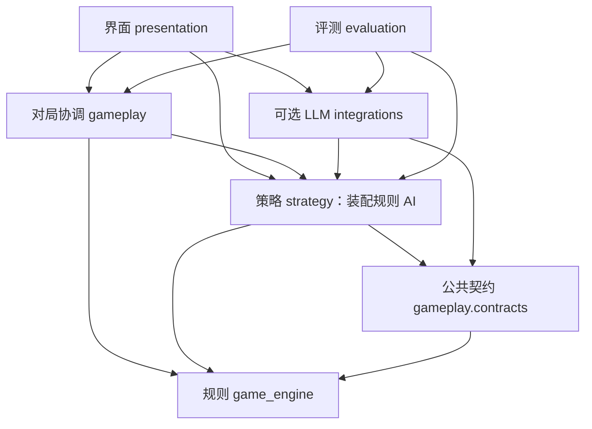

# 三部分架构与修改边界

更新：2026-11-02。

项目围绕三部分组织：**界面显示、规则合法性、出牌策略**。它们通过稳定的数据和动作接口
协作。规则决定“能不能出”，策略决定“合法动作中怎么选”，界面决定“怎样让人看见和操作”。
对局轮转、进还贡和升级属于连接三者的协调工作，单独放置，避免塞入界面或策略。

## 正式实现

| 归属 | 目录 | 内容 | 不应放入 |
| --- | --- | --- | --- |
| 1. 界面与显示 | `presentation/` | gui、viewer、play、统计窗口、牌面、PASS、LLM设置窗口 | 牌型判定、策略评分、HTTP请求实现 |
| 2. 规则 | `game_engine/` | 牌、牌型、识别、比较、红心配、合法组合、发牌、进贡规则、终局判定 | 保炸弹偏好、队友让牌策略、窗口和模型配置 |
| 3. 策略 | `strategy/` | `rule_agent.py` 出牌选择；`planner.py` 分组、路线评估与策略选项 | Tk、凭据、网络、完整牌局或对手底牌 |
| 对局协调 | `gameplay/` | `contracts.py` 观测/动作接口；`match.py` 单局；`series.py` 多局；`progression.py` 共享升级；`offline.py` 离线控制；`actions.py` 公共合法动作；`turn_log.py` 记录 | 显示控件、模型通信 |
| 可选LLM适配 | `integrations/llm/` | DeepSeek/兼容模型代理、本地客户端、提示词、凭据设置、请求用量 | 修改牌型规则、作为离线游戏的必需依赖 |
| 评测和经验 | `evaluation/` | 统计、报告、运行辅助、经验样本读写和复核案例评估 | 自动训练或在运行中改写策略/规则 |



`gameplay/__init__.py` 和其他包入口不预加载模块；策略引用 `gameplay.contracts` 不会反向
加载对局协调器。规则包不依赖任何上层包。LLM 和规则 AI 的合法动作来自同一规则来源，
LLM 不通过 `RuleAgent._beats` 之类的策略内部方法定义合法性。

## 保留的入口及兼容

以下运行方式保持可用：

```bash
python play.py
python gui.py
python viewer.py
python benchmark_gui.py
python match_runner.py
python game_series.py
```

根目录这些文件和 `card_ui.py`、`play_display.py`、`llm_settings.py`、`llm_dialog.py`、
`play_game.py`、`benchmark.py` 等已成为兼容入口；`agents/` 内原路径也保留为兼容导入。
兼容模块指向同一个正式模块，不复制类或策略实现，旧测试的 patch 和类身份保持一致。
新业务代码使用正式包路径；**不要在兼容入口里添加另一套实现**。

例如：

```python
from strategy.rule_agent import RuleAgent
from gameplay.contracts import Action, Agent, Observation
from gameplay.offline import PlayGame
from presentation.cards import CardFace
```

`presentation/cards.py` 是牌面正式实现，仍可 `from card_ui import CardFace`；共享视觉规范
继续位于 `assets/card_style/`。本次没有修改另一项目的任何文件。

## 哪种修改去哪里

- 改桌面布局、字体、选牌手势、状态显示：`presentation/`。桌面计时器保留在界面层。
- 改某牌型的张数、大小、红心配识别：`game_engine/`；这是规则变更，必须同时修改牌例测试。
- 改拆牌、留炸、队友配合、报单处理、残局路线：`strategy/`，不改规则比较器。
- 改轮到谁、人工动作提交、跨局进还贡：`gameplay/`，通过 `Match` 的公开动作方法协调。
- 改模型、接口、超时、提示词：`integrations/llm/`；配置控件在 `presentation/llm_dialog.py`。
- 收集口诀、复核模型决策、比较策略版本：`evaluation/` 和经验案例，见
  [策略改进流程](strategy_improvement.md)。

界面通过公共观测、动作及合法结果显示牌局，不自行实现规则。`Match.prepare_turn()`
统一处理最后一名玩家自由领出，避免人工界面和异步模型各实现一份状态转换。
`advance_levels()` 统一计算桌面观察、人机和离线控制的升级、A级双下终止，界面只显示结果。
`take_turn()`、`observation()`、`play_cards()`、`pass_turn()`、`apply_action()`、
`is_finished()` 和 `round_result()` 提供协调入口；旧私有入口暂时保留兼容。
`PlayGame` 接受 `agent_factory`，可替换离线策略而不修改牌桌控件。

## 自动约束与验证

```bash
python tests/run_all.py
# 以下需在有桌面会话的环境分别运行
python tests/gui_smoke.py
python tests/gui_modes_smoke.py
python tests/gui_llm_smoke.py
python tests/gui_llm_features_smoke.py
python tests/gui_play_status_smoke.py
python tests/benchmark_gui_smoke.py
python tests/play_smoke.py
python tests/viewer_llm_smoke.py
```

`tests/test_architecture.py` 扫描正式包，包括函数内导入，检查依赖方向、界面/网络依赖泄漏、
兼容模块身份和打包目录登记。它是静态检查，不能证明所有运行时行为，仍需规则牌例、策略
场景及真实 Tk 测试共同验证。禁止在正式包里回头引用兼容模块绕过边界。

修改某一层不应要求修改其他层，前提是公共契约保持稳定。字段变更、规则语义变化可能影响
消费者，应当视为跨层变更并运行相关回归，不能承诺任何修改都绝不会产生影响。

本次按重构前状态保留策略行为：种子 42、101、2026 各连续 500 步的完整状态摘要与重构前
逐组一致；原牌型识别、比较、候选枚举和进贡实现未改写。新增规则合法候选入口只复用已有
枚举与比较函数。结构调整不等于已提升棋力，也没有自动应用尚未复核的口诀。

## 移动端

`game_engine/`、`strategy/`、`gameplay/` 不依赖 Tk 或模型客户端，可作为后续移动端复用
或移植的核心。Tk 组件仍需替换为移动端界面；JSON状态和手牌编号接口位于
`gameplay/offline.py`，旧 `play_game.py` 继续可用。详细说明见 [移动端准备](play_mobile.md)。

## 源码同步和发布范围

2026-11-02起停止更新及发布 `gui.exe`。原 `.github/workflows/windows-release.yml`
已替换为 `.github/workflows/source-tests.yml`，只运行核心、分层和桌面回归，不构建或上传
可执行文件，不创建Release。历史Release和附件保留，`gui.spec` 留作历史构建参考。
后续界面、规则和策略更新均以GitHub源码为准。
